<!-- Dono: Jonathan Locks. Revisar quando: lançar um projeto aberto, a startup sair do modo fechado, ou mudar de papel. Última revisão: 2026-10. -->

Sou founder, consultor de IA para empresas e entusiasta da área. Trabalho com engenharia de prompt e engenharia de contexto: escrevo as instruções, a memória e o contexto que fazem modelos como o Claude e o ChatGPT entregarem um trabalho confiável.

Já programei em Java, Python e JavaScript. Hoje construo com ferramentas como Claude Code e Codex.

### Especialidades

- Frameworks para agentes de IA: sistemas de skills, subagentes e workflows.
- Engenharia de contexto: organizar o conhecimento de uma empresa para que os agentes deixem de só responder perguntas e passem a fazer o trabalho.
- Servidores MCP, que ligam os agentes a dados e ferramentas internas.

### Aprofundando

- Orquestração de agentes: um modelo coordenando vários subagentes em tarefas longas.
- Contexto aprovado: bases de conhecimento em que o agente só usa o que tem fonte, foi revisado por uma pessoa responsável e ainda está valendo.

### O que vai aparecer aqui

Meus projetos e material aberto para a comunidade: skills, frameworks e plugins para agentes de IA, em português.

### Com o que trabalho

