<!-- Dono: Jonathan Locks. Revisar quando: lançar um projeto aberto, a startup sair do modo fechado, ou mudar de papel. Última revisão: 2026-10. -->

Sou founder e entusiasta de IA. Trabalho com engenharia de prompt e engenharia de contexto: escrevo as instruções, a memória e o contexto que fazem modelos como o Claude e o ChatGPT entregarem um trabalho confiável.

Já programei em Java, Python e JavaScript. Hoje construo com ferramentas como Claude Code e Codex.

### O que vai aparecer aqui

Meus projetos e material aberto para a comunidade: skills, frameworks e plugins para agentes de IA, em português.

### Com o que trabalho

